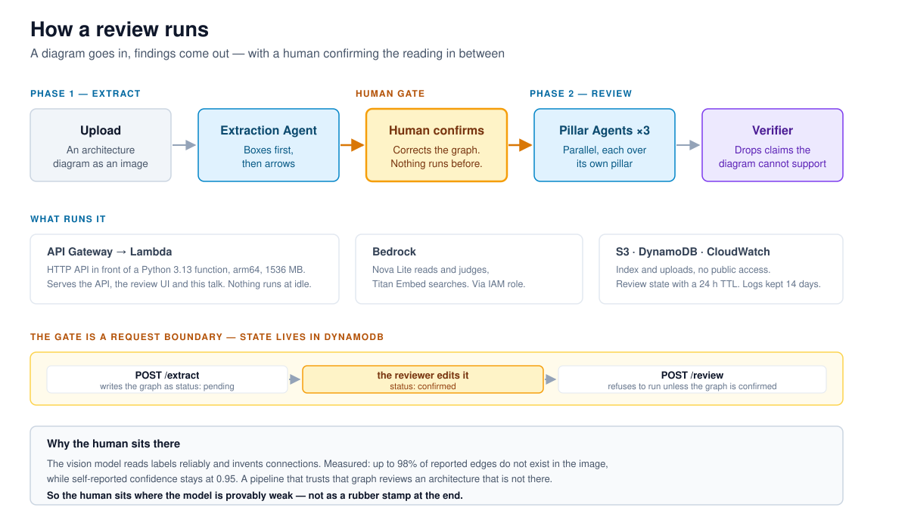
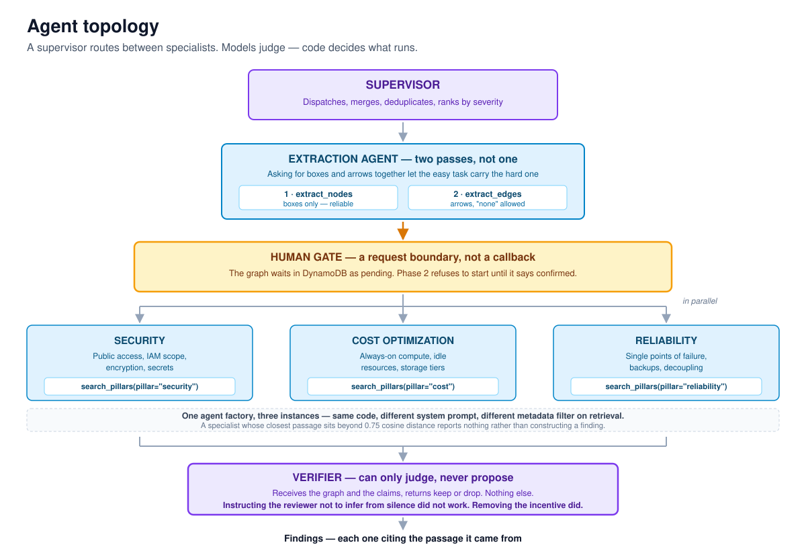

# Well-Architected Review Agent


A multimodal AI pipeline that reads an **AWS architecture diagram as an image** and reviews it against the AWS Well-Architected Framework — with a human confirming the reading at the point where the model is measurably unreliable.

> Ironhack Final Project (GenAI). Individual work.

---

## The problem

When someone asks whether an AWS architecture is sound, usually one artefact exists: a diagram in a slide deck. No Terraform state, no configuration export — a picture.

Checking it by hand means holding 178 best practices in your head and comparing them against that picture. It takes days, so it rarely happens. This automates the first pass, and is explicit about the one step a model cannot be trusted with.

---

## How it works



```
PHASE 1 — EXTRACT (AI)          HUMAN GATE          PHASE 2 — REVIEW (AI)

  Upload  →  Extraction Agent → Human confirms  → Pillar Agents ×3 →  Findings
    │              │                  │                  │               │
 S3 + API      Bedrock            DynamoDB          index in S3      Lambda +
   Gateway    (Nova Lite)                                           CloudWatch
```

### Agent topology



| Agent | Role | Tools |
|---|---|---|
| **Supervisor** | Routes, merges, deduplicates, ranks | — |
| **Extraction Agent** | Image → graph, in two passes | `read_diagram` |
| **Pillar Agents ×3** | Security, Cost, Reliability — in parallel | `search_pillars(pillar=…)` |
| **Verifier** | Judges whether each finding is supported | — |

The three pillar agents are **one factory instantiated three times**: same code, different system prompt, different metadata filter on retrieval.

Routing is code, not a model. A reviewer that occasionally forgets to run a pillar would be worse than one that always runs all three, and nothing about that decision needs judgement. Models do the judging — reading a diagram, weighing an architecture against guidance. Code does the control flow.

---

## What the measurements changed

Every structural decision here came from a measurement, and two of them overturned the first design.

### 1. The vision model invents connections

A spike before any code was written, on a real 1924×1959 px diagram:

| | Result |
|---|---|
| Box labels (OCR) | **Excellent** — all 21 read correctly |
| Connections | **Invented** — the boxes were chained into a sequence not in the picture |
| Self-reported confidence | **Unusable** — 0.95 throughout, nothing flagged as unclear |

Splitting extraction into two passes — boxes first, then arrows, with "no arrows visible" made an explicitly acceptable answer — improved this substantially but did not fix it:

Reading a diagram turned out to be three abilities that fail separately, so
they are scored separately:

| Test case | Boxes found | Services named | Edges traced | Hallucinated edges |
|---|---|---|---|---|
| `01_simple_api` — flat, generated | 100% | 100% | 100% | **0%** |
| `02_flawed_webapp` — flat, generated | 100% | 100% | 60% | **50%** |
| `03_arcentry_3d` — isometric, from Terraform | **100%** | **0%** | 3% | **98%** |

**The boxes are always found. What breaks is first the connecting, then the
naming.** The third case is an isometric rendering with vendor 3D models and
rotated labels — exported from Arcentry, which generated it from this
project's own Terraform plan. Every box is located and not one service is
identified, and the labels themselves start to degrade: `drift-check` is read
as `diff-check`, `schedule-dlq` as `scheduled`.

That is a sharper statement than the project started with. The model is an
excellent reader of horizontal text and a poor reader of pictures — and once
the text stops being horizontal, the reading goes too.

**So a human confirms the graph before any review runs.** Not as a rubber stamp at the end — at the one step where the model is provably weak, and only there.

### 2. Telling a model not to hallucinate does not work

The first review agents had this in their system prompt:

> *Never write that something is missing, disabled or unencrypted because the diagram is silent about it.*

With that instruction in place, the deliberately **flawless** test diagram still drew findings about missing mTLS, an unnamed availability zone and absent CloudFront. Strengthening the wording made it worse.

A model that wants to be useful will find something. Instruction competes with that pull, and loses.

**The fix was structural, not rhetorical:** a separate call that can only judge, never propose. It receives the graph and the proposed findings and returns keep or drop. Having no incentive to find something, it rejects the inferences.

### 3. Specialists see what a generalist misses

Retrieval measured across pillars: for unambiguous questions, filtering changes nothing. For topics belonging to several pillars, an unfiltered search returns one pillar and stops.

```
"the workload is deployed across multiple availability zones"
  unfiltered:       reliability, 3 of 3 — the cost of cross-zone traffic never appears
"backups of the database"
  unfiltered:       reliability, 3 of 3 — whether they are encrypted is never asked
```

Filtering does not produce better passages. It **forces a perspective that would otherwise never be taken**.

---

## Evaluation

Two baselines, each removing exactly one decision and keeping the rest, so the difference is attributable. Means over repeated runs; temperature is 0 and the same diagram still does not produce the same review twice.

`python evaluation/run.py --runs 5` · raw numbers in [`evaluation/results/evaluation.json`](evaluation/results/evaluation.json)

### Tracing

Every Bedrock call is traced to **LangSmith** under the project
`well-architected-review-agent` — six chat calls and three embedding calls per
review, each with its prompt, response, latency and token count. That is where
the per-review cost in the tables below is read from rather than estimated.

Tracing is optional by design: without `LANGSMITH_API_KEY` the decorator hands
back the undecorated function and the pipeline runs unchanged. A step that only
observes should not be able to stop the thing it observes.

### On the diagram with four planted problems

| Configuration | Found | **Of 4 planted** | False positives | Latency | Cost |
|---|---|---|---|---|---|
| B1 — specialists, no verification | 5.2 | **3.4 / 4** | 1.8 | 2.3 s | $0.00045 |
| B2 — one generalist, verified | 3.6 | **2.2 / 4** | 1.4 | 5.0 s | $0.00044 |
| **Full pipeline** | 5.0 | **3.0 / 4** | 2.0 | 3.8 s | $0.00055 |

### On the two diagrams where the correct answer is zero

| Configuration | `01_simple_api` | `03_arcentry_3d` |
|---|---|---|
| B1 — no verification | 5.0 | 6.4 |
| B2 — one generalist | **0.8** | **0.2** |
| **Full pipeline** | 1.2 | 2.8 |

### Reading the numbers

- **Verification is what keeps the output honest.** On the two clean diagrams it cuts false positives from 5.0 to 1.2 and from 6.4 to 2.8, for 1.5 seconds and $0.00008. It is not free in recall: on the flawed diagram the full pipeline lands at 3.0 of 4 against B1's 3.4, so the verifier occasionally rejects a real finding along with the invented ones.
- **The fan-out is a trade, not a win.** The specialists find 3.0 of 4 planted problems where a single generalist finds 2.2 — 36% better on the case the tool exists for. They also produce more false positives on diagrams that have no problems (1.2 against 0.8, and 2.8 against 0.2). Three reviewers looking for faults find more imaginary ones than one reviewer does.
- **The third case shows the failure mode that matters.** Extraction collapsed completely — no service identified, 98% of edges invented — and the review still reported nothing, because the verifier rejected all four speculative findings. **The parts fail independently, and the system becomes useless before it becomes wrong.**
- **Cost is counted, not estimated.** Every Bedrock call records its tokens: about **$0.0005 per review**, or two thousand reviews per dollar.

### What is still wrong

- Clean diagrams draw one to three false positives per run. The verifier catches most inferences from silence, not all.
- Verification sometimes rejects a real finding. 3.0 of 4 against 3.4 without it — precision is bought with a little recall, not none.
- Pillar attribution drifts: missing backups are sometimes filed under cost.
- Isometric diagrams are not usable. Boxes are found, nothing else survives.
- Results vary between runs despite temperature 0, which is why every number above is a mean over five.

---

## Running it

### Local

```bash
python3 -m venv .venv && source .venv/bin/activate
pip install -r requirements-dev.txt && pip install -e .
cp .env.example .env

python backend/ingestion/fetch_corpus.py     # download the whitepapers
python backend/ingestion/build_index.py      # chunk, validate, embed (~5 min)
python backend/ingestion/export_index.py     # flat array for deployment

uvicorn backend.api.main:app --reload        # http://localhost:8000
```

Needs AWS credentials with Bedrock access in `us-east-1`, and `graphviz` (`brew install graphviz`) to regenerate test diagrams.

For tracing, three variables in `.env`:

```bash
LANGSMITH_API_KEY=lsv2_pt_...
LANGSMITH_TRACING=true
LANGSMITH_PROJECT=well-architected-review-agent

# EU-hosted accounts need this. The client defaults to the US region and
# returns 403 Forbidden against it, which looks like a bad key.
LANGSMITH_ENDPOINT=https://eu.api.smith.langchain.com
```

### Deploy

```bash
source deployment/infra/manual/00_variables.sh
bash deployment/infra/manual/10_storage.sh      # S3, DynamoDB
bash deployment/infra/manual/20_iam.sh          # role and policy
bash deployment/infra/manual/30_package.sh      # zip, upload index
bash deployment/infra/manual/40_lambda.sh       # function
bash deployment/infra/manual/50_apigateway.sh   # HTTP API
```

Each service gets its own numbered script so the order is visible and single steps can be repeated. `90_teardown.sh` removes everything.

> **On the demo endpoint:** this runs in a shared teaching account whose access ends with the course, so no permanent URL is promised. The scripts rebuild it in about five minutes, and the stack is torn down after the demo rather than left reachable.

### Tests

```bash
pytest                   # 41 tests, AWS mocked with moto, no network, no cost
ruff check backend/ evaluation/
```

---

## Design decisions

| Decision | Choice | Reasoning |
|---|---|---|
| Model provider | **Amazon Nova Lite** on Bedrock | Anthropic models are blocked in the shared account — Bedrock requires a use-case form that should not be submitted against an account one does not own. Nova is multimodal, available, cheaper. |
| Model id | `us.amazon.nova-lite-v1:0` | The `us.` inference-profile prefix is mandatory; the bare id is rejected with `ValidationException`. |
| Auth to Bedrock | **IAM role** | No API key stored anywhere. |
| Vector store | **Chroma** to build, **numpy array** to serve | chromadb carries 82 MB of ONNX runtime for an embedding model nothing here calls. Both paths return identical passages at identical distances. |
| Packaging | **zip**, not a container | 60 MB of dependencies fits Lambda's limit with room to spare, and needs no registry or image pull. |
| Compute | Lambda, arm64, 1536 MB | Graviton is cheaper per ms; Lambda scales CPU with memory, so paying for a shorter cold start is cheaper than a long one. |
| HTTP | **API Gateway**, not a function URL | Public function URLs are blocked at the organisation level in this account — correct policy, `AuthType NONE`, still 403. An HTTP API is where throttling and an authorizer belong anyway. |
| HITL state | DynamoDB, two endpoints | Lambda is stateless, and explicit state is inspectable when something goes wrong. |
| Upload | In the request, not presigned | Diagrams sit well under the payload limit; one round trip is simpler to operate and demonstrate than three. |
| Relevance floor | 0.75 cosine distance | Where a pillar has nothing to say, its closest passage sits around 0.87. Below the floor a specialist reports nothing instead of constructing something. |

---

## Repository

```
backend/
  agents/        extraction, pillar factory, verifier, supervisor
  tools/         retrieval with the pillar filter
  api/           FastAPI: /extract, /review/{id}
  core/          config, models, Bedrock access, state store
  ingestion/     corpus download, chunking, indexing, export
frontend/        upload and human correction UI
deployment/
  infra/manual/  one numbered script per service
evaluation/
  datasets/      generated diagrams with their ground truth
  run.py         the evaluation
experiments/     measurements, including what did not ship
tests/           pytest + moto
docs/diagrams/   architecture and agent topology
```

### Test data

Two cases are generated from code, so the ground truth is exact rather than hand-labelled — which is what makes the hallucinated-edge rate measurable at all. `01_simple_api` is deliberately flawless, to catch a reviewer that invents findings to look useful. `02_flawed_webapp` carries one violation per pillar, stated on the node labels because a vision model can only report what the picture says.

The third, `03_arcentry_3d`, is not generated by `generate.py`. It was exported from Arcentry, which built it from this project's own Terraform plan — so its ground truth comes from infrastructure code rather than from a drawing. It exists because the first two share one visual style, and a test set that only contains what the system handles well measures nothing.

---

## Known limitations

- **Three pillars, not six.** The factory scales to all six; three were run to keep latency and cost in budget, and because ground truth exists for those three.
- **Isometric diagrams do not work.** Measured, not assumed: `03_arcentry_3d` locates every box and identifies no service, with 98% of edges invented. The pipeline is usable on flat diagrams with horizontal labels and not beyond that.
- **The human gate is mandatory, by design.** This is not a fire-and-forget tool and does not try to be.
- **`REL12-BP06` is absent from the corpus** — it never appears as a heading in the source PDF, only as a cross-reference. Recorded in `KNOWN_ABSENT` so the completeness check stays strict.

---

## Credits and sources

- **AWS Well-Architected Framework** whitepapers — published by AWS, used as the retrieval corpus
- **Amazon Bedrock** — Nova Lite for vision and reasoning, Titan Embed v2 for retrieval
- **Chroma** — vector store for index construction
- **LangSmith** — tracing and per-call cost accounting
- **FastAPI**, **Mangum**, **diagrams** — API, Lambda adapter, test fixtures
- **Tooling** — AWS CLI, Claude Code

## License

MIT — see [LICENSE](LICENSE).
